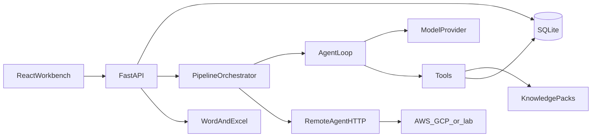

# Architecture

The workbench is a local-first web application. Engineers run it on an OEM workstation. Agents execute in-process or on a remote worker. The requirements register is the system of record.



## Components

### Workbench UI

React and TypeScript, built with Vite. Six surfaces:

- **Pipeline** — stage board with an agent node per agent (status, duration, turns, tokens; run, rerun, cancel), full-cycle start, headline metrics, and a side panel per agent with the live **trace** (model turns, reasoning, tool calls and results), its **output**, and its **prompt and tools**
- **Review** — the proposal inbox as a list and detail view: statement, rationale, acceptance criteria, capabilities, traced findings; accept as Draft or In Review, edit then accept, reject; keyboard driven
- **Requirements** — the register with search and filters, and a detail drawer with version history
- **Cognitive coverage** — the CL1–CL5 ladder and every capability with the requirements that cover it
- **Run log** — every run with model, turns, tokens, duration, and its trace
- **Export** — Word and Excel downloads and a supplier-issue readiness checklist

### API

Python and FastAPI in one process. Background agent runs stay inside that process. A separate queue service is not required for the first implementation.

The API owns:

- Requirement and proposal persistence
- Agent-run records
- Orchestration commands
- Export generation

### Register store

SQLite on the workstation. The store holds requirements, versions, proposals, findings, and run logs. Export reads the store. It does not regenerate requirements from scratch.

### Orchestrator

Decides which agents may run, in what order, and with which saved inputs. See [05-pipeline.md](05-pipeline.md).

### Agents

Every agent implements one contract, whether it runs locally or remotely. A local agent is a system prompt, a tool set, and dependencies; its behaviour comes from a model provider driven by the agent loop. Until the program selects a model, a **simulated provider** plays the model. See [03-agents.md](03-agents.md), [07-remote-agents.md](07-remote-agents.md), and [11-agent-runtime.md](11-agent-runtime.md).

Local agents read versioned knowledge packs shipped with the workbench. See [08-knowledge-baseline.md](08-knowledge-baseline.md) and [09-cognitive-companion.md](09-cognitive-companion.md).

### Export

Word and Excel built from the register at request time. See [06-export.md](06-export.md).

## Runtime choices for the first implementation

| Topic | Choice |
| --- | --- |
| UI | React, TypeScript, Vite |
| API | Python, FastAPI |
| Store | SQLite |
| Agent execution | In-process agent loop by default; HTTP worker when configured |
| Model provider | Simulated until selected; adapters for Claude API, Claude on Vertex AI, Gemini, OpenAI-compatible |
| Credentials | None required for a simulated run |

A simulated run needs no key and no network. The pipeline still produces stakeholder needs, system requirements, findings, traces, and both export files.

Live forum scraping is not part of the first implementation. The customer-expectations agent reads a maintained theme pack. A remote worker may later replace that pack by returning findings through the same contract.

## Configuration

Configuration lives in `config/agents.yaml`: the project block (name, deployment assumption, target cognitive level) and one entry per agent:

- `mode: local` runs the in-process agent
- `mode: remote` sends the run to an HTTPS `endpoint`
- `mode: bedrock` invokes an Amazon Bedrock AgentCore harness; its tools still run in the workbench

A cloud account is required only for agents whose mode is `remote` or `bedrock`.

## Repository layout

```
backend/
  app/
    main.py            FastAPI routes
    config.py          config/agents.yaml loader
    db.py              SQLite schema and connection
    models.py          Shared result, finding, proposal, requirement
    register.py        ID allocation, accept, reject, versioning
    orchestrator.py    Stage DAG, background runs, cancel
    compliance.py      Deterministic gate rules
    runtime/           Agent loop, tools, events, model providers, simulation policies
    cognition.py       Capability catalog and coverage rule
    agents/            Agent definitions, system prompts, remote client
    knowledge/packs/   Versioned knowledge packs (YAML)
    export/            Excel and Word builders
  tests/
frontend/              React + TypeScript + Vite workbench
config/agents.yaml
```

## What stays constant when an agent moves to the cloud

The workbench still stores the run, the findings, and the proposals. The UI still shows status and still requires a person to accept proposals. Only the execution host changes.
