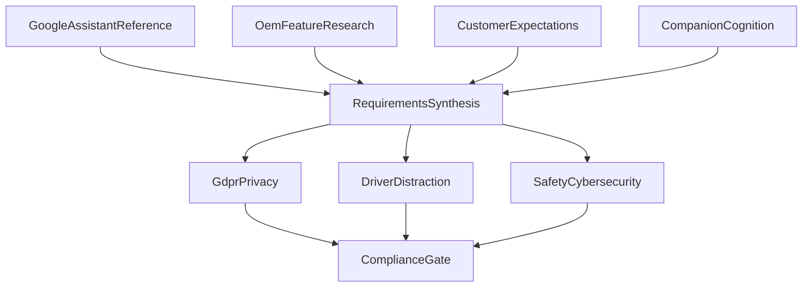

# Agents

Nine agents maintain the SEW1 baseline. Each one returns findings and, where its role allows, proposed requirements. The compliance gate returns findings only.

Each local agent is defined by a system prompt (`backend/app/agents/prompts/`), a tool set, and its dependencies. The agent loop in [11-agent-runtime.md](11-agent-runtime.md) drives a model provider through tool calls until the model calls `submit_result`; that call carries the shared result below. The **Reads** line of each agent names what its tools expose.

## Shared result

Every agent returns:

- `agent_id`
- `status` — succeeded or failed, plus a short error when failed
- `summary` — a paragraph an engineer can read in the control room
- `findings` — sourced observations (title, statement, source, confidence)
- `proposals` — requirement drafts, omitted for the compliance gate
- `metrics` — optional key-value results; the compliance gate reports `specified_cognitive_level` here. The runtime adds `provider`, `model`, `turns`, `input_tokens`, `output_tokens`, and `latency_ms`

A proposal carries the fields in [04-requirements.md](04-requirements.md) except lifecycle state. The workbench assigns state **Proposed** and does not write baselined text.

Research-agent proposals are **candidates**: they are stored on the run and consumed by synthesis. The inbox receives the merged set from synthesis and the proposals of the assurance agents, so one behaviour reaches a reviewer once.

## Stage order

| Stage | Agents | Starts when |
| --- | --- | --- |
| Research | Google assistant reference, OEM feature research, Customer expectations, Companion cognition | The engineer starts them, together or alone |
| Synthesis | Requirements synthesis | All four research agents have a succeeded run, or the engineer reruns synthesis against the latest saved research |
| Assurance | GDPR and privacy, Driver distraction, Safety and cybersecurity | Synthesis has a succeeded run |
| Gate | Compliance gate | The three assurance agents have a succeeded run |

A single-agent rerun uses the latest saved outputs of the agents it depends on. It does not clear the register.

## 1. Google assistant reference

**Purpose.** Capture driving-mode capabilities of Google’s in-car assistant as reference requirements: navigation, media, calls and messages, car controls, and offline limits.

**Reads.** Knowledge pack section “Google assistant reference” in [08-knowledge-baseline.md](08-knowledge-baseline.md).

**Writes.** Findings that cite the capability, and proposals in `SYS-FUNC`, `SYS-HMI`, and `SYS-PERF` where a capability should become an OEM requirement. Proposals name Google assistant as a reference source, not as a requirement to ship Google’s product.

## 2. OEM feature research

**Purpose.** Compare production assistants and propose capabilities the OEM should match, exceed, or explicitly exclude.

**Reads.** Knowledge pack section “Production assistants”.

**Writes.** A feature comparison as findings, plus proposals only where the comparison justifies an OEM requirement. Each proposal names the assistant and the feature it responds to.

Cover at least: Mercedes-Benz MBUX Voice Assistant, BMW Intelligent Personal Assistant, Tesla voice commands, and one further production assistant from the knowledge pack.

## 3. Customer expectations

**Purpose.** Turn known complaint and expectation themes into stakeholder needs and system requirements.

**Reads.** Knowledge pack section “Customer themes”. A remote worker may later supply an equivalent finding list from an approved research service. The first implementation does not crawl forums.

**Writes.** Stakeholder needs (`STK-`) and system requirements that trace to a theme. Themes include misrecognition, offline use, recording privacy, unintended car-control actions, and distraction.

## 4. Companion cognition

**Purpose.** Specify the cognitive behaviour that makes the assistant a partner rather than a command parser, up to the program’s target cognitive level.

**Reads.** The capability catalog, action tiers, and companion principles in [09-cognitive-companion.md](09-cognitive-companion.md) (knowledge pack “Companion cognition”), the target level from the project configuration, and the current register so already-covered capabilities are not proposed twice.

**Writes.**

- One finding per capability stating whether the register already covers it
- `SYS-COG` proposals for each uncovered capability at or below the target level, each carrying its **Cognitive capability** ID, a verification method, and acceptance criteria drawn from the verification measures
- CL0–CL4 proposals as Must; CL5 proposals as Should, with the companion principle they depend on in the rationale

## 5. Requirements synthesis

**Purpose.** Merge the four research outputs into one coherent set of `shall` statements.

**Reads.** Latest findings and proposals from agents 1–4, plus the current register so baselined IDs are respected.

**Writes.** Proposals with statement, rationale, source, category, priority, verification method, and acceptance criteria.

**Rules.**

- Use an existing requirement ID when the proposal updates an existing item
- Leave baselined statement text unchanged; the person accepts a new version
- Do not invent a second requirement for the same behavior
- Deduplicate overlapping research proposals and keep every source on the surviving item
- Keep the **Cognitive capability** ID; when two proposals for the same behaviour cite different capabilities, keep both IDs

## 6. GDPR and privacy

**Purpose.** Add or tighten requirements for in-cabin voice data.

**Reads.** Synthesis proposals, the register, and the privacy section of the knowledge pack.

**Writes.** `SYS-PRIV` proposals covering lawful processing themes, recording indication, passenger and guest data, minimization, transparency, retention, and deletion. Rationale cites the GDPR theme.

For companion behaviour it also covers personal and episodic memory (COG-08, COG-09), learning (COG-19), and opt-in affect awareness (COG-16), including the EU AI Act transparency and emotion-recognition themes. Those proposals stay In Review until legal confirmation. The proposal remains subject to privacy review.

## 7. Driver distraction

**Purpose.** Constrain interaction so the assistant does not demand visual-manual attention while driving.

**Reads.** Synthesis proposals, the register, and the distraction section of the knowledge pack.

**Writes.** `SYS-DIST` and related `SYS-HMI` proposals: dialogue length, lockouts above a speed threshold, eyes-off-road, and confirmation of high-impact actions by voice. It also proposes workload-aware timing for proactive speech (COG-13) and limits on open conversation and fatigue prompts while driving (COG-16, COG-17). References include ISO 15005 themes and NHTSA visual-manual distraction themes.

## 8. Safety and cybersecurity

**Purpose.** Classify hazard candidates and add safety and security requirements.

**Reads.** Synthesis proposals, the register, and the safety and cybersecurity section of the knowledge pack.

**Writes.**

- `SYS-SAFE` proposals with a **preliminary** ASIL and the note “to be confirmed by the safety manager”
- `SYS-SEC` proposals for voice spoofing, command injection, and update integrity
- `SYS-SAFE` proposals assigning an action permission tier to each car-domain function (COG-14), and grounding requirements against invented vehicle status (COG-11)
- `SYS-SEC` proposals for prompt injection through spoken, messaged, or calendar content reaching the planner (COG-10)
- Findings that name the standard: ISO 26262, ISO 21448, ISO/PAS 8800, ISO 21434, UN R155, UN R156

Most dialogue, media, and navigation behaviors are proposed as QM. Hazard candidates that need an explicit preliminary class include emergency call, child-lock and window commands, and any voice path that could engage or disengage driver assistance.

## 9. Compliance gate

**Purpose.** Check the register and the open proposals before export.

**Reads.** The full register, open proposals, and findings from the assurance agents.

**Writes.** Findings and metrics only. No new product requirements.

Checks:

- Required attributes present on every item that is Draft, In Review, or Baselined
- Identifier prefix matches category
- Each baselined item has a verification method and acceptance criteria
- Preliminary ASIL on `SYS-SAFE` items is still marked for safety-manager confirmation
- Open proposals that contradict a baselined statement
- Baselined items with no source
- Assurance findings that no requirement traces to
- Cognitive coverage: every capability at or below the target level is covered under the rule in [09-cognitive-companion.md](09-cognitive-companion.md); one finding per uncovered capability
- A COG-12 (proactive) item with no `SYS-DIST` item citing COG-13
- A CL5 (`COG-15`–`COG-17`, `COG-09`) item in Baselined without a privacy reviewer on its change note

The gate reports the **specified cognitive level** in `metrics`.

The control room lists gate findings as open items until an engineer closes them or accepts a proposal that resolves them.

## Status values

Each agent run is one of: idle, queued, running, succeeded, failed, cancelled.

The control room shows the latest run for each agent: status, start time, finish time, and summary. Failed and cancelled runs stay in the log. The next run does not delete them.
