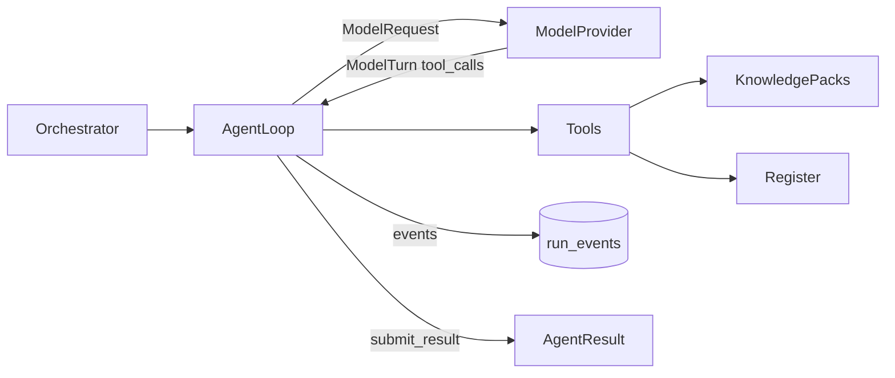

# Agent runtime

Agents are provider-neutral. Each one is a system prompt, a tool set, and its dependencies. The **agent loop** drives a **model provider** through tool calls until the model submits its result. Until the program selects a model, a **simulated provider** plays that role, so the whole workbench runs today without a key and a real model can replace it without other changes.

## Loop

1. The orchestrator builds the run context: project, register, latest succeeded dependency runs, open proposals.
2. The loop sends a `ModelRequest`: system prompt, transcript, tool specs.
3. The provider returns a `ModelTurn`: optional reasoning text, optional message, tool calls, token usage.
4. The loop runs each tool call and appends the results to the transcript. Tool errors go back to the model as error results.
5. When the model calls `submit_result`, the loop validates the input against the shared result schema ([03-agents.md](03-agents.md)). An invalid submission goes back to the model as an error so it can correct it.
6. The run fails if the model has not submitted within `runtime.max_turns`. Cancel is checked between turns.

The runtime adds `provider`, `model`, `turns`, `input_tokens`, `output_tokens`, and `latency_ms` to the result metrics.

## Tools

| Tool | Returns | Used by |
| --- | --- | --- |
| `search_knowledge(pack, query?)` | Pack metadata and entries | Research and assurance agents |
| `get_capability_catalog()` | Capabilities up to the target level, principles | Companion cognition |
| `get_cognitive_coverage()` | Coverage rows, specified and target level | Companion cognition, gate |
| `list_requirements(category?, state?)` | Current register items | All except gate |
| `list_open_proposals()` | Inbox titles and IDs | Synthesis, assurance |
| `get_dependency_output(agent_id)` | Findings and proposals of an upstream run | Synthesis, assurance |
| `get_vehicle_signals(domain?)` | Signal catalog, triggers, response types | Vehicle context |
| `check_scenarios(scenarios)` | Rule check of GIVEN / WHEN / THEN drafts | Vehicle context |
| `run_compliance_checks()` | Deterministic rule results with severity | Gate |
| `submit_result(summary, findings, proposals, metrics?)` | Ends the run | All |

Tools only read. The register changes only through human review. An agent can call only the tools in its definition.

## Events

Every run stores an ordered trace that the Pipeline page and the Run log show live.

| Type | Data |
| --- | --- |
| `start` | provider, model, tool names |
| `turn` | turn number, stop reason, latency, input and output tokens |
| `thinking` | reasoning text from the model |
| `message` | visible text from the model |
| `tool_call` | call ID, tool name, input |
| `tool_result` | call ID, tool name, error flag, preview |
| `result` | summary, finding and proposal counts, token totals |
| `error`, `cancelled` | message |

API: `GET /api/runs/{run_id}/events?after={seq}`.

## Simulated provider

`runtime.provider: simulated` selects it. A policy per agent (`backend/app/runtime/simulation/`) plays the model:

- It sees only the `ModelRequest`. Everything it writes comes from tool results already in the transcript, never from the database, as with a real model.
- It calls independent tools in parallel, reasons in plain language about what it found, and ends with `submit_result`.
- Latency per turn (`latency_ms`), token counts estimated from the text exchanged, and an optional `failure_rate` let the UI and orchestration be exercised realistically. Tests set `SEW1_SIM_LATENCY_MS=0`.

The simulation is deterministic in content: the same packs and register give the same findings and proposals. It is a stand-in for model judgement, not a substitute for review.

## Swapping in a real provider

1. Choose the adapter in `backend/app/runtime/providers/`: `anthropic` (Claude API), `vertex` (Claude on Vertex AI), `gemini`, or `openai_compat`. Each file states its auth and the mapping to and from the neutral types.
2. Implement `generate(ModelRequest) -> ModelTurn`: send the system prompt, transcript, and tools; return reasoning, text, tool calls, stop reason, and usage.
3. Set `runtime.provider` and `runtime.model` in `config/agents.yaml`, plus the provider block (key variable name, project, region, or base URL). A single agent can override `model`.
4. Run the pipeline. Prompts, tools, the trace, the result schema, review, and export are unchanged.

Until an adapter is implemented, selecting it fails each run with a clear message and leaves the register untouched.
